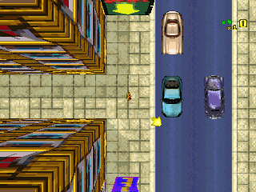
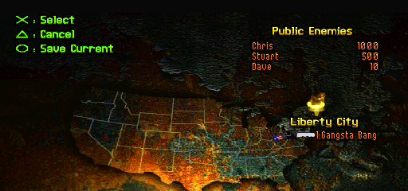
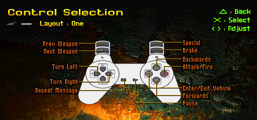

# GTA1Sim

A headless, parallel reinforcement-learning environment for the original
1997 *Grand Theft Auto* (PlayStation).

The real game runs inside a [libretro](https://docs.libretro.com/) core
driven frame by frame from Python — authentic game logic, collision,
traffic and mission scripts, with no X server, no Xvfb and no RetroArch.
Nothing is paced by wall-clock time, so N copies run as fast as the CPU
allows and the same inputs always produce the same trajectory.

```
 pcsx_rearmed_libretro.so   the game, stepped by retro_run()
          ▲ ctypes
   gta1env/libretro.py      headless frontend: frames, input, 2 MiB RAM, savestates
          ▲
   gta1env/env.py           Gymnasium env: frameskip, 84×84 stack, RAM-based rewards
          ▲
   gta1env/vec.py           N processes → one shared-memory observation block
          ▲ pinned buffer
   train_ppo.py             PPO on CUDA
```

All of these were captured on a headless server with no display, no
X server and no GPU involved in rendering:

| | |
|---|---|
|  |  |
| Gameplay, Liberty City | Level select |

## Requirements

- Linux, x86-64
- GCC and Make (to build the core)
- Python 3.12+
- A CUDA GPU for training (the environment itself is CPU-only)
- Your own copy of the game — see [Game files](#game-files)

## Install

```bash
git clone <this repo> && cd GTA1Sim

# build the libretro core
git clone --depth 1 https://github.com/libretro/pcsx_rearmed.git third_party/pcsx_rearmed
make -C third_party/pcsx_rearmed -f Makefile.libretro platform=unix -j$(nproc)

# python environment
uv venv --python 3.12 .venv
uv pip install numpy gymnasium opencv-python-headless tensorboard
uv pip install pygame        # optional: tools/play.py --ui desktop
uv pip install torch --index-url https://download.pytorch.org/whl/cu126
```

Verify the install without any game files:

```bash
gcc -O2 -fPIC -shared -o tests/mock_core_libretro.so tests/mock_core.c
.venv/bin/python tests/test_pipeline.py      # 24 checks against a mock core
```

## Game files

You supply these yourself; they are not distributed here.

### Disc image → `roms/`

GTA for PlayStation, as `.cue`+`.bin`, `.chd`, `.img` or `.pbp`. Rip your
own disc — PS1 discs are Mode 2/2352 and usually carry CD-DA audio
tracks, so a plain ISO rip loses data:

```bash
redumper --drive /dev/sr0 --image-name gta          # -> gta.bin + gta.cue
chdman createcd -i gta.cue -o gta.chd               # optional, ~40% smaller
```

Prefer an **NTSC** release (US, `SLUS-00106`): 60 Hz instead of PAL's
50 Hz is ~20% more emulated frames per second for the same CPU. Verify a
rip against the [Redump](http://redump.org/) hashes. Region and revision
also affect the button mapping in `CONTROLS`.

### BIOS → `bios/` (optional)

The core has a built-in high-level BIOS, so no file is needed:

```bash
.venv/bin/python tools/drive.py --hle
.venv/bin/python train_ppo.py --bios-mode HLE
```

HLE trades compatibility for convenience and changes boot timing, so
keep the setting fixed for a whole experiment. For a real BIOS, dump it
from a console you own (FreePSXBoot needs no modchip; Unirom over
serial, or a PSIO/xStation cart, also work). It must be exactly 524,288
bytes and should match your disc's region.

Then check everything is in place:

```bash
.venv/bin/python tools/check_assets.py
```

## Quick start

```bash
# 1. boot the game once by hand and freeze a savestate for fast resets.
#    Reach the main menu (~frame 4000), pick New Game, play until you
#    have control, then `boot`. Everything after is instant resets.
.venv/bin/python tools/drive.py

# 2. locate the reward values in RAM (see below)
.venv/bin/python tools/ram_scan.py known --at cash100=100 --at cash250=250
.venv/bin/python tools/ram_scan.py set cash 0x800A1234 --size 4

# 3. see what this machine sustains
.venv/bin/python tools/bench.py --envs 1,4,8,12,16

# 4. train -- model-free PPO, or the JEPA world-model flywheel
.venv/bin/python train_ppo.py --envs 12 --total-steps 10000000
.venv/bin/python train_jepa.py --envs 12 --iters 8 --run-name jepa1
tensorboard --logdir runs/
```

## Using the environment

```python
import gymnasium as gym
import gta1env                      # registers GTA1-v0

env = gym.make("GTA1-v0", frameskip=4, grayscale=True)
obs, info = env.reset(seed=0)                  # obs: uint8 (4, 84, 84)
obs, reward, terminated, truncated, info = env.step(action)
```

A standard Gymnasium environment — it passes `gymnasium.utils.env_checker`
and that check runs in the test suite. Keyword arguments to `gym.make` are
`GTA1Config` fields. The disc in `roms/` is found automatically; pass
`rom_path=` to override.

`info` carries every field from your RAM map (cash, health, wanted level,
coordinates…), so you can log or build a custom reward from it.

Equivalent explicit forms:

```python
from gta1env import GTA1Env, GTA1Config
env = GTA1Env(GTA1Config(frameskip=4))         # or GTA1Env(frameskip=4)

import gta1env
env = gta1env.make(frameskip=4)                # one env
vec = gta1env.make(num_envs=8, frameskip=4)    # eight, one process each
```

In parallel — one process per emulator, frames shared without pickling:

```python
from gta1env.vec import SubprocVecEnv

vec = SubprocVecEnv(12, cfg_kwargs={"frameskip": 4})
obs, infos = vec.reset()                        # obs: (12, 4, 84, 84) uint8
obs, rewards, terms, truncs, infos = vec.step(actions)
frames = vec.obs_to_torch("cuda")               # pinned staging -> CUDA
```

Episodes autoreset; `info["episode_ended"]` marks the boundary.

### Configuration

`GTA1Config` fields worth knowing:

| field | default | |
|---|---|---|
| `frameskip` | 4 | emulated frames per agent step |
| `obs_width` / `obs_height` | 84 | observation size |
| `grayscale`, `frame_stack` | `True`, 4 | |
| `episode_steps` | 4500 | ~5 minutes of play (not `max_episode_steps`, which `gym.make` reserves) |
| `noop_max` | 30 | random no-ops at reset, for diversity |
| `boot_state` | `config/boot.state` | a savestate, or a **directory** of `*.state` sampled per reset |
| `sticky_prob` | 0.0 | action-repeat stochasticity |
| `bios_mode` | `"auto"` | `"HLE"` to run without a BIOS file |
| `cash_scale`, `score_scale` | 0.01, 0.01 | reward per unit of cash/score |
| `distance_scale` | 0.0 | dense reward per world unit moved |
| `death_penalty` | 1.0 | penalty when a death is inferred |

### Actions

14 discrete actions built from named intents, so remapping is one edit
in `gta1env/ram.py`. The mapping is taken from the game's own Control
Selection screen (Layout One), not guessed:



```python
CONTROLS = {"forward": "cross", "backward": "triangle", "brake": "r2",
            "turn_left": "left", "turn_right": "right",
            "fire": "circle", "enter_exit": "square", "special": "r1",
            "prev_weapon": "l1", "next_weapon": "l2",
            "repeat_message": "select", "pause": "start"}
```

Note the d-pad only steers — forwards and backwards are face buttons.
`tools/probe_controls.py` holds each button from the boot state and
reports how much of the screen and RAM changed, if you need to re-derive
this for another region or control layout.

### Episode start states

Resets restore a savestate rather than rebooting the console, which is
what makes them instant. The cost is that a single state means every
episode opens on the identical frame: all workers spawn in the same
street and explore the same corner of Liberty City, however they are
seeded. `boot_state` therefore also accepts a **directory**, sampled per
reset, and `info["boot_index"]` reports which one an episode used.

```bash
# drive around with a trained checkpoint, snapshotting along the way
.venv/bin/python tools/make_boot_states.py --count 16 \
    --out config/boot_states --policy runs/NAME/checkpoint.pt \
    --min-steps 1000 --max-steps 4000

.venv/bin/python train_ppo.py --boot-state config/boot_states
```

Use a policy, not random actions, to generate them: **random input barely
explores**. Measured over ~11,000 random steps the player never left a
240×335 unit box, because random input mills in place instead of
travelling — 16 such states are 16 copies of one street corner. The tool
reports the pairwise spread it achieved so this is visible rather than
assumed.

Neither mode produces *intent*. States parked next to a mission phone
need hand-driving with `tools/drive.py`, and can be dropped into the same
directory alongside the generated ones.

### Rewards

Reward comes from reading the game's own state out of the PS1's 2 MiB
main RAM. There is no published RAM map for GTA (PS1), so the addresses
were found empirically and are shipped in `config/ram_map.json`, verified
against the **NTSC-U release (SLUS-00106)**:

| field | address | notes |
|---|---|---|
| `score` | `0x8002C2F0` | u32, dollars as shown on the HUD |
| `player_x` | `0x8002C96C` | i32, 16.16 fixed point world X |
| `player_y` | `0x8002C970` | i32, 16.16 fixed point world Y |

The default shaper turns score gains into reward (`score_scale`, 0.01 per
point, so a $100 pickup is +1.0).

Score is **sparse** — roughly one event per 3,000 steps of random play.
`distance_scale` adds a dense movement term as a bootstrap signal; at
0.001 a typical episode earns about 7.5 from movement against 5.0 from
score, so score still matters. It is off by default:

```bash
.venv/bin/python train_ppo.py --distance-scale 0.001
```

A dense term that pays every step will out-earn one that pays every few
thousand, and left at full weight it becomes what the policy actually
maximises — measured at **80% of the return gain** over a 10M-step run
(see [learning/naive/](learning/naive/)). So anneal it: movement gets the
agent driving, then hands the credit back to the game's own signals.

```bash
.venv/bin/python train_ppo.py \
    --distance-scale 0.001 --distance-scale-final 0.0 \
    --reward-anneal-frac 0.5 --score-scale 0.05
```

| flag | |
|---|---|
| `--distance-scale-final` | target weight; reached after `--reward-anneal-frac` of training |
| `--reward-anneal-frac` | fraction of training spent annealing (default 0.5) |
| `--score-scale` | reward per point of score (env default 0.01) |

Because a shaped return mixes the terms, it cannot say *what* improved.
The trainer logs `charts/episodic_score` and `charts/episodic_distance`
separately, and `tools/eval_policy.py` reports both against a random
policy:

```bash
.venv/bin/python tools/eval_policy.py --ckpt runs/NAME/checkpoint.pt \
    --envs 6 --steps 9200
```

Death is inferred from a large jump in the player's position, since no
lives address is known yet. The threshold (`respawn_distance`, 1500) sits
well above anything ordinary: measured over 40,000 steps, normal motion
peaks near 32 units/step and entering or leaving a vehicle snaps the
player by up to ~512, while a real teleport was ~5,200. A lower
threshold would fire on getting into a car and teach the agent to avoid
vehicles. Set it to 0 to disable.

**Other regions will differ** — PAL and NTSC-J builds relocate these.
Re-derive them with `tools/ram_scan.py`; two search strategies cover
almost everything:

*Known values.* When you can read the number off the HUD, snapshot RAM
at two or more different values and intersect:

```bash
# in drive.py:  snap zero  ... earn points ...  snap hundred
.venv/bin/python tools/ram_scan.py known --at zero=0 --at hundred=100
.venv/bin/python tools/ram_scan.py set score 0x8002C2F0 --size 4
```

*Behaviour.* When you cannot read the value, describe how it moves.
Rules are `inc`/`dec` (strict), `ge`/`le` (tolerates pauses), `same` and
`any`, one per gap, and `--save`/`--only` intersect separate experiments.
A player coordinate, for example, rises while walking forward, falls
walking backward, and never moves while idle:

```bash
.venv/bin/python tools/ram_scan.py delta --snaps fwd_0,...,fwd_7 \
    --pattern ge,ge,ge,ge,ge,ge,ge --signed --changed --save fwd.txt
.venv/bin/python tools/ram_scan.py delta --snaps bwd_0,...,bwd_7 \
    --pattern le,le,le,le,le,le,le --signed --changed --only fwd.txt \
    --save both.txt
.venv/bin/python tools/ram_scan.py delta --snaps idle_0,...,idle_5 \
    --pattern same,same,same,same,same --only both.txt
```

The `same`-while-idle step is what removes frame counters and timers,
which otherwise dominate any "always increasing" search.

Recognised names: `cash score health armor lives wanted player_x player_y
player_z in_vehicle mission_id level_complete game_over`. The shaper uses
`cash`/`score`/`health`; the rest ride along in `info`. **If the map is
empty, every reward is 0** — deliberately, so a dead reward signal is
obvious rather than silent.

Savestates make this far easier than on hardware: save a state, snapshot,
do the thing, snapshot again, load back.

## Tools

| | |
|---|---|
| `tools/check_assets.py` | validate BIOS md5 and `.cue` references |
| `tools/drive.py` | interactive console: boot, savestates, ASCII frame preview over SSH |
| `tools/ram_scan.py` | find reward addresses in RAM snapshots |
| `tools/probe_controls.py` | report what each button does |
| `tools/bench.py` | steps/s and emulated fps sweep |
| `tools/make_boot_states.py` | build a directory of varied episode start states |
| `tools/eval_policy.py` | score and distance of a checkpoint vs. random |
| `tools/play.py` | play in a browser or a desktop window and record the session (see [PLAY.md](PLAY.md)) |
| `tools/replay.py` | turn recordings into `(obs, action, reward)` datasets |
| `tools/contrib.py` | check a contributor's setup; pack and unpack submitted sessions (see [CONTRIBUTE.md](CONTRIBUTE.md)) |

`drive.py` prints an ASCII rendering of the framebuffer, so you can
navigate menus over SSH without copying screenshots around. Record a
command sequence to a file and replay it with `--script` to rebuild a
boot state reproducibly.

## Performance

Every number below was measured on one machine, and a modest one. It is
worth naming, because these are reference points from
fourteen-year-old silicon rather than a ceiling:

| | |
|---|---|
| CPU | Intel Xeon E5-2690 @ 2.9 GHz — 8 cores / 16 threads (Sandy Bridge-EP, 2012) |
| GPU | NVIDIA GTX 1050 Ti, 4 GiB |
| RAM | 62 GiB |

`tools/bench.py` reproduces the sampling figures on your own hardware.

### Sampling is the bottleneck

Roughly one core per environment; the policy network is trivial by
comparison and the GPU idles most of the loop. Observations stay uint8
from the emulator all the way into VRAM, and only the last frame of each
frameskip window is converted to RGB — the other three are never looked
at, so they skip conversion entirely.

Measured in-game, frameskip 4:

| workers | agent steps/s | emulated fps | vs. realtime |
|---|---|---|---|
| 1 | 457 | 1,826 | 30× |
| 8 | 1,411 | 5,645 | 94× |
| 16 | 1,886 | 7,543 | 126× |

Per-worker throughput falls off well before the core count — these are
memory-bandwidth bound, not compute bound — so measure rather than
assuming linear scaling.

### Pipelining the rollout

In training the emulators also have to share with the policy, so the
rollout is pipelined: the envs are split into two halves stepped out of
phase, and while one half's emulators are busy the other half's
observations go through the GPU. Each env's own trajectory stays
contiguous in time, so PPO is unaffected. The pipeline is also left full
across update boundaries, which keeps the emulators working during the
optimize phase. Measured with 12 envs:

| | rollout | optimize | throughput |
|---|---|---|---|
| lockstep (`--no-pipeline`) | 2.10 s | 0.47 s | 597 steps/s |
| pipelined (default) | 1.22 s | 0.47 s | **911 steps/s** |

1.53×, taking a 10M-step run from 4.7 h to 3.0 h. Going from 12 to 16
envs adds only 2%, so there is little left to win from more workers.

### Observation resolution is cheaper than it looks

Measured with 12 envs, geometry the only variable:

| observation | pixels | throughput | cost |
|---|---|---|---|
| 84×84 (DQN default) | 7,056 | 885 steps/s | baseline |
| 128×96 (4:3, current) | 12,288 | 770 steps/s | −13% for 1.7× the pixels |
| 160×120 (4:3) | 19,200 | 650 steps/s | −27% for 2.7× the pixels |

Pixels scale sub-linearly into cost, because the resize is a small part
of a step next to emulating four frames. That matters, because 84×84
throws away most of the frame: measured against the native 320×240, it
retains 22% of the high-frequency detail versus 37% at 160×120. Paying
13% of throughput to see the road is a good trade, and 128×96 is the
default for that reason. (The 128×96 row is taken from a training run
that also carries the novelty reward — a set lookup per step, well under
a percent.)

### Where the time actually goes

One update is 1536 steps across 12 envs at 128×96:

| | |
|---|---|
| rollout | 1.26 s |
| optimize | 0.69 s |
| GPU during rollout | 11–14% |
| GPU during optimize | 79–83% |
| VRAM | 811 MiB of 4,096 |
| CPU busy | ~5.8 of 16 threads |

The GPU is near-idle for two-thirds of every update and never uses a
quarter of its memory, so a bigger card buys nothing here — the 1050 Ti
is not what is slow. More physical cores would help, and so would the
unexploited trick of toggling the libretro video-enable bit on frames
the agent never sees, which would skip rasterisation entirely on three
frames in four.

### Training runs end to end

| run | observation | steps | throughput | wall clock |
|---|---|---|---|---|
| [naive baseline](learning/naive/) | 84×84 | 10M | 866 steps/s | 3.2 h |
| run 2 | 128×96 | 10M | 770 steps/s | 3.6 h |

10M agent steps is 40M emulated frames — about 7.7 days of game time at
60 fps, compressed into three and a half hours on one desktop GPU and a
2012 Xeon. That is the number that makes the project practical: a full
training run is an afternoon, not a cluster booking.

## Notes

**Determinism.** Same savestate plus same actions gives the same
trajectory. Every threaded path in the core is disabled
(`DETERMINISTIC_CORE_OPTIONS` in `gta1env/env.py`) — a background
recompiler, GPU or SPU thread makes frames vary run to run. Audio is
hard-disabled through the libretro `GET_AUDIO_VIDEO_ENABLE` bits, the
single biggest headless win. Because the emulator is deterministic,
exploration diversity comes from `noop_max` and `sticky_prob`.

**One core per process.** libretro cores keep global state, so two
`LibretroCore` objects in one process corrupt each other. `SubprocVecEnv`
uses one spawned process per emulator, pinned to a CPU, sharing only the
observation block.

## Training approaches

Each training approach that has actually been run is written up under
[learning/](learning/) with its config, its results and its failure
modes, so the reasoning behind the current defaults is recoverable:

| | |
|---|---|
| [learning/naive/](learning/naive/) | sparse score + constant dense movement shaping. Return rose 11.5 → 15.0, but ~80% of the gain was the movement term, not the game. Baseline; do not build on. |

`train_jepa.py` is the model-based alternative. It has been run on the
real game, but only on random-play data, where it did no better than the
"nothing changes" copy baseline: a random agent stays on foot and stands
still about 70% of the time, so there is little action signal to learn.
It is paused until a PPO policy or human recordings supply data where
the player drives. It learns a LeJEPA-style world model (CNN encoder, action-conditioned
latent predictor, SIGReg instead of EMA/stop-grad, a reward/death head),
trains the policy inside it on imagined rollouts, and loops: collect →
world model → policy → evaluate. Each stage is cached under
`runs/<name>/iterNN/`, so rerunning the same command resumes. Its
`wm_diag/*` scalars are the ones to watch: `pred_over_copy_K` must be < 1
(beats "nothing changes"), `shuffled_over_pred_K` > 1 (uses the actions),
`act_sens` well above 0 (predictor not collapsed).

## Layout

```
gta1env/libretro.py    headless ctypes libretro frontend
gta1env/env.py         Gymnasium env + deterministic core options
gta1env/ram.py         RAM field map, control mapping, reward shaper
gta1env/vec.py         shared-memory multiprocess vector env
tools/                 asset checks, interactive console, RAM scanner, benchmark
tests/                 mock libretro core + end-to-end pipeline tests
train_ppo.py           PPO, CUDA
train_jepa.py          JEPA world model + imagination actor-critic flywheel
RESOURCES.md           disc / VSR / text / mission-script / RAM formats
config/                ram_map.json, boot.state
```

## Legal

This repository contains no game data. You need your own copy of the
game, and a BIOS image only if you choose not to use HLE. `pcsx_rearmed`
is licensed separately by its authors.
